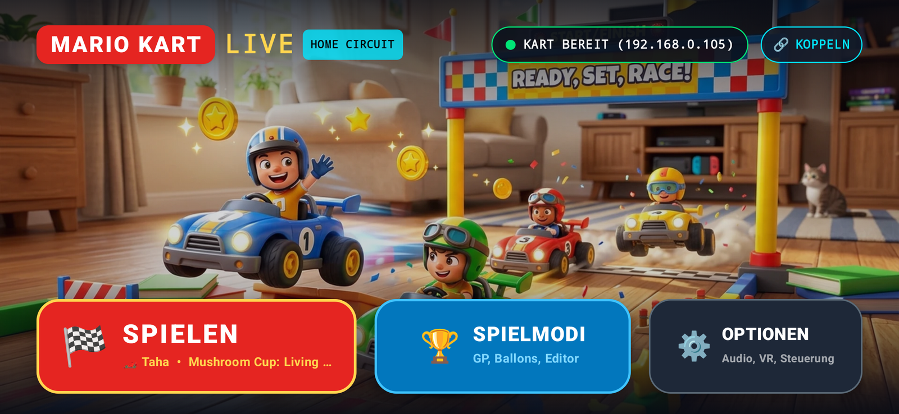
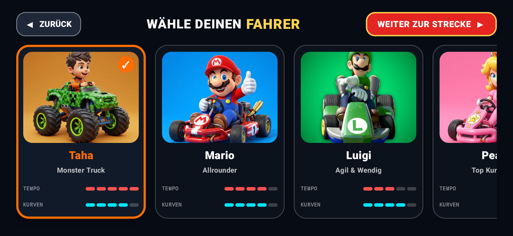
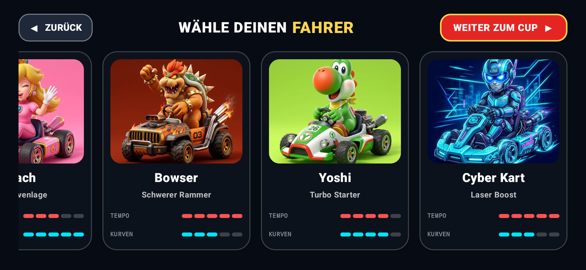
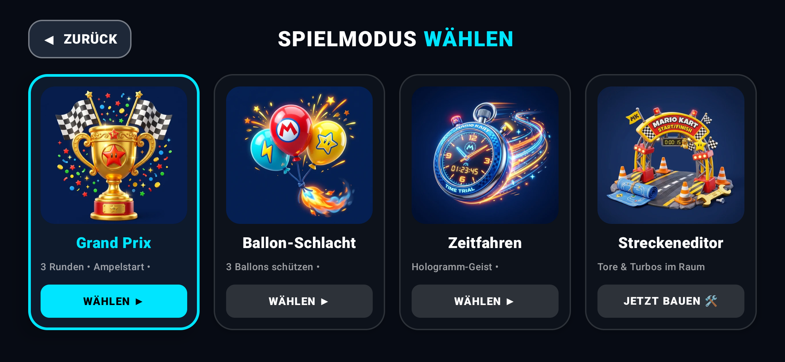
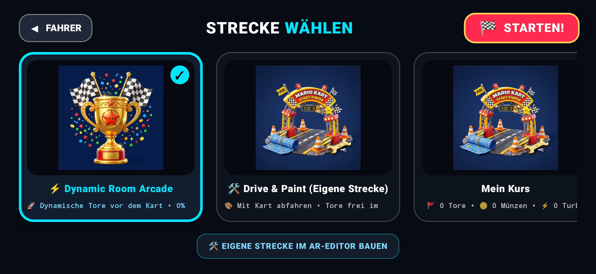
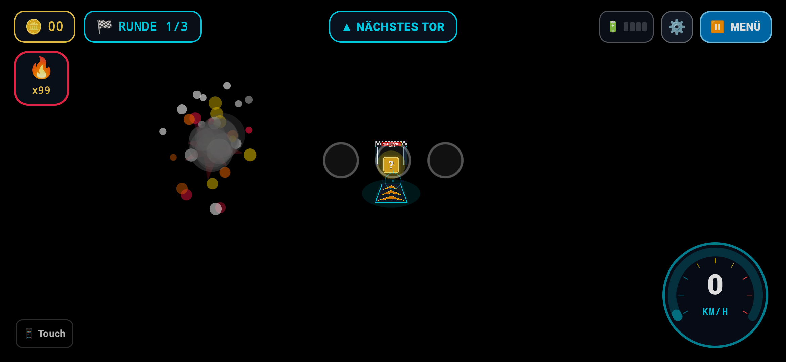
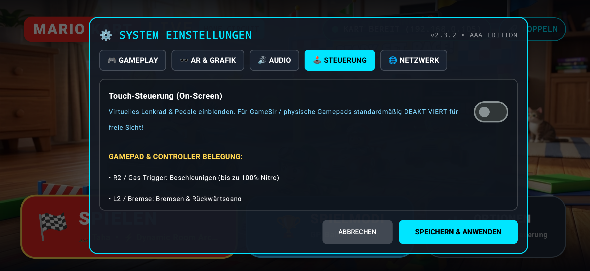
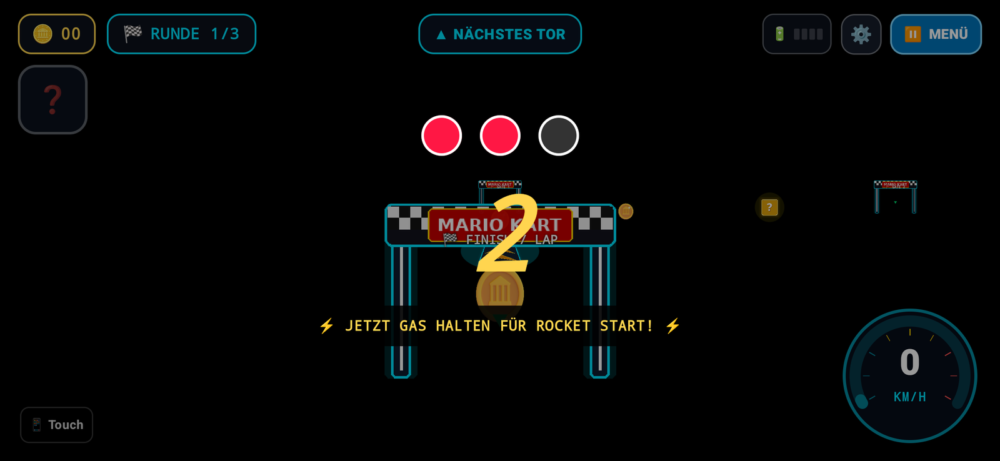

# MK Live Cockpit & Base Station

Drive and record **Mario Kart Live: Home Circuit** — now with **Meta Quest 3 VR Mode** & **AAA Arcade UI**! 🏎️🥽💨

<p align="center">
  
</p>

---

## 📸 Ingame & UI Showcase (v2.4.0 AAA Edition)

| 🏎️ Fahrer-Auswahl (Taha & Mario) | 🦖 Fahrer-Auswahl (Bowser & Yoshi) |
| :---: | :---: |
|  |  |
| **Taha (Minecraft Creeper Monster Truck), Mario, Luigi, Peach** | **Bowser (Flame Buggy), Yoshi, Cyber Kart** |

| 🏆 Spielmodi & Grand Prix | ⚡ Strecken-Auswahl (Dynamic & Custom) |
| :---: | :---: |
|  |  |
| **Grand Prix, Ballon-Schlacht, Zeitfahren, Streckeneditor** | **⚡ Dynamic Room Arcade & Drive & Paint Circuit** |

| 🚀 3D Raketen-Kampf & Partikel | 🕹️ GameSir Controller Priorität |
| :---: | :---: |
|  |  |
| **Red Shell Rakete mit Rauch/Feuer-Schweif & Ampelstart** | **Freie Kamerasicht (Touch-Controls optional deaktivierbar)** |

<p align="center">
  
  <br>
  <em>🏁 Dynamisches Cockpit-HUD: 3D AR-Tore, Münzen, Turbo-Pads, Speedometer & Rundenzeiten</em>
</p>

### 📄 Druckbare DIN-A4 Smart-Marker (`docs/markers/`)
Bereit zum Ausdrucken für deine Wohnung:
* 🖨️ **[HTML Druckvorlage öffnen (`docs/markers/print_markers.html`)](docs/markers/print_markers.html)**: Mit `Strg + P` direkt im Browser auf DIN-A4 ausdrucken!
* **Tor 1 bis 4 (Checkpoints & Start/Ziel)**: Drift-freies optisches Tracking beim Vorbeifahren.
* **No-Go Zonen / Virtuelle Wände**: Warnbarrieren und Sperrzonen vor Möbeln und Wänden.

---

## 🌟 Highlights & Key Features (v2.4.0 AAA Edition)

* **⚡ Dynamic Room Arcade (0% Wandkollisionen & Möbel-Clipping):**
  * **Intelligenter Fahrkorridor:** Anstelle starrer, fest platzierter Strecken, die in Sofas oder Wänden enden, projiziert die Dynamic Room Engine Tore, Münzen und Turbo-Pads fortlaufend direkt vor das Kart in Fahrtrichtung (bei 2.5m, 5.0m und 7.5m).
  * **Flüssiger Spielfluss:** Jedes durchfahrene Tor triggert sofort einen Sound- und Partikeleffekt, zählt die Rundenzeit und spannt nahtlos den nächsten Streckenabschnitt auf.
* **🛠️ "Drive & Paint" Streckeneditor & Custom Circuits:**
  * **Wohnungs-Rundkurs abfahren:** Fahre mit dem echten Kart deine Wunschstrecke in der Wohnung ab. Start/Ziel, Checkpoints 1 bis 4, Münzenfelder und Dash-Pads werden genau an deiner realen Fahrspur platziert.
  * **Persistente Speicherung:** Eigene Strecken werden lokal gespeichert und stehen im Streckenmenü sofort zur Auswahl.
* **🎮 GameSir / Bluetooth Gamepad Fokus & Clean FPV Cockpit:**
  * **Hardware-Controller First:** Optimiert für GameSir G8 Galileo, G8+, X2s sowie Xbox Wireless, PlayStation DualSense und Switch Pro Controller.
  * **Optionale Touch-Buttons:** Auf Smartphone und Tablet lassen sich On-Screen Touch-Buttons in den Einstellungen (`Optionen -> Touch-Steuerung einblenden`) komplett ausblenden – für eine freie, ungestörte FPV-Kamerasicht wie im echten Rennkart!
  * **60 Hz Hardware V-Sync Input Loop:** Sub-Millisekunden-Reaktionszeit zwischen Stick-Eingabe und Kart-Lenkmotor.
* **🚀 3D Waffen-Arsenal & Visuelle Partikeleffekte:**
  * **3D Red Shell Rakete:** Plastisch gerendertes 3D-Geschoss mit feurigem Flammen-Schweif, animiertem Rauch und parabolischer Flugbahn.
  * **18 Hz Minigun:** Zwillingsrohr-Mündungsfeuer mit dynamischer Lichtreflektion auf dem Boden, Leuchtspurmunition und Kameraschütteln.
  * **Bob-Omb EMP:** 3D-Bombe mit brennender Lunte und expandierender Schockwellen-Druckwelle.
  * **Bananenschalen:** Physikalisch auf dem Boden abgelegte Hindernisse mit 360°-Dreher bei Berührung.
* **🪙 Interaktive 3D Goldmünzen & Item-Boxen:**
  * Rotierende 3D-Goldmünzen mit Stern-Prägung (+1.5% Speed-Buff pro Münze bis zu +15% Maximalgeschwindigkeit).
  * Holographische Fragezeichen-Würfel mit pulsierendem Glow und Item-Roulette.
  * Turbo Boost Dash-Pads mit fließenden Neon-Chevrons und High-Speed-Warp-Streifen.
* **🔊 Low-Latency SoundPool SFX & Dynamischer Motorensound:**
  * Prozedural synthetisierter 16-Bit PCM 44.1 kHz Arcade-Audio-Synthesizer.
  * Stufenlose Tonhöhen-Modulation des Kart-Motors synchron zu Gashebel und Telemetrie.
* **🥽 Meta Quest 3 Stereoskopisches 3D-AR:**
  * Side-by-Side (SBS) Dual-Viewport Rendering mit einstellbarem Augenabstand (IPD).
* **🛠️ Skia ColorMatrix Farbraum-Korrektur:**
  * Hardwarebeschleunigter RGB/BGR Channel-Swapper zur Behebung vertauschter Rot-/Blaukanäle auf Google Tensor (Pixel 7 Pro) und Mali-GPUs.

---

## 🎮 Controller Combat Mapping

### Meta Quest Touch Plus & Gamepads (Xbox, PlayStation, Switch Pro)

| Input | Combat Function | Description |
| :--- | :--- | :--- |
| **Right Trigger (R2 / RT)** | **Throttle (0 – 70%)** | Sensitive analog acceleration for precision cornering |
| **Left Trigger (L2 / LT)** | **Brake & Reverse** | Decelerate or reverse |
| **Left Stick** | **Analog Steering** | Proportional steering Left / Right |
| **L1 / LB (Hold)** | **🔥 Minigun (Gatling)** | 18 Hz rapid-fire rotary cannon with tracers & screen shake |
| **R1 / RB** | **🎯 Weapon Select / Horn** | Cycle active item or honk car horn |
| **X Button / Square (□)** | **🚀 Lock-On Missile** | Guided rocket with radar target tracking & explosion |
| **Y Button / Triangle (△)** | **💣 Bob-Omb / EMP** | High-explosive shockwave clearing obstacles |
| **B Button / Circle (○)** | **🍌 Banana Peel Drop** | Deploys rear banana hazard (or dialog back in menus) |
| **A Button / Cross (✕)** | **🍄 Boost / Active Item** | 100% Nitro Boost or triggers current roulette weapon |
| **D-Pad Up** | **🚩 Set Checkpoint Gate** | Drops a virtual checkpoint / finish gate at current position |
| **D-Pad Down / Select** | **🥽 Toggle VR Mode** | Switch between 2D Cockpit and Immersive 3D SBS View |
| **Thumbstick Click (L3/R3)**| **🧭 Reset Orientation** | Zero out artificial horizon heading |

---

## 🏗️ Architecture & How It Works

```text
 ┌────────────────┐
 │ Mario Kart Live│
 └───────┬────────┘
         │ 802.11 LP2P (Nintendo Wi-Fi Direct)
         ▼
 ┌─────────────────────────────────────────────────────────┐
 │ PC / Raspberry Pi Base Station                          │
 │                                                         │
 │  ┌──────────────┐     UDP 19001 (H.264)   ┌───────────┐ │
 │  │  OpenKart    ├────────────────────────►│  Video    │ │
 │  │  hostapd AP  │                         │  Worker   │ │
 │  │              ├───────┐                 └─────┬─────┘ │
 │  └──────┬───────┘       │ UDP 19002 (IMU)       │ Stream│
 │         ▲               ▼                       ▼ :9001 │
 │         │          ┌──────────┐            ┌──────────┐ │
 │         └──────────┤  Drive   │◄───────────┤ Web/WS   │ │
 │          Control   │  Server  │  Commands  │ Server   │ │
 │                    └──────────┘            └────▲─────┘ │
 └─────────────────────────────────────────────────┼───────┘
                                                   │
                  LAN / Wi-Fi (WebSocket + HTTP)   │
                                                   ▼
                       ┌─────────────────────────────────────────┐
                       │ Android App (Phone or Meta Quest 3 VR)  │
                       │ • Flat Screen HUD / 3D SBS VR Cockpit   │
                       │ • Telemetry-driven Artificial Horizon   │
                       │ • Quest Touch & Bluetooth Gamepad Input │
                       │ • Hardware H.264 Video Dec / Recorder   │
                       └─────────────────────────────────────────┘
```

1. **OpenKart SDK:** Runs an 802.11 access point tailored to Nintendo's LP2P protocol and handles the initial pairing handshake and encrypted communication.
2. **Video Worker (`video_worker.py`):** Reassembles UDP RTP H.264 packets into a clean stream for both native decoders and MJPEG fallback on port `9001`.
3. **Drive Server (`drive_web.py`):** Translates WebSocket control inputs into Nintendo control packets and streams IMU telemetry on port `9000`.
4. **Android & Quest App:** Connects to the base station via WebSocket and HTTP, receives video and telemetry, handles input at 60 Hz hardware V-Sync, and renders both 2D HUD and immersive 3D VR stereoscopic views.

---

## 🚀 Installation & Setup Guide

### 1. Base Station Setup (Linux PC / Raspberry Pi)

**Prerequisites:**
- Linux (Ubuntu 22.04+, Debian 12+, Fedora, or Arch Linux)
- Wi-Fi adapter supporting AP mode (SoftMAC / mac80211, e.g. Intel Wi-Fi or Atheros AR9271)
- Python 3.10+

**Starting the Services:**
Execute the automated starter script:
```bash
./scripts/start_basis_station.sh
```
Or use the desktop shortcut `Start_Basis_Station.desktop`.

To check service status:
```bash
systemctl --user status mk-live-openkart mk-live-video mk-live-web
```

---

### 2. Meta Quest 3 Sideloading (VR Mode)

1. Enable **Developer Mode** on your Meta Quest 3 using the Meta Quest mobile app (under Devices -> Headset Settings -> Developer Mode).
2. Connect the Quest 3 via USB-C or Wi-Fi ADB.
3. Run the automated installer:
   ```bash
   ./scripts/install_quest3.sh
   ```
   *(Or double-click `Install_Quest3.desktop` on Linux)*
4. Alternatively, sideload using SideQuest or standard ADB:
   ```bash
   adb install -r -g app-quest-release.apk
   ```
5. Inside the Quest 3 headset, open **App Library** -> filter by **Unknown Sources** -> launch **MK Live** (look for the Mario icon wearing the VR headset!).
6. Configure the Base Station IP in **Settings**, grab your Touch Controllers, and press **[Y]** to drive in full VR!

---

### 3. Android Smartphone Installation

1. Download `app-phone-release.apk` from the [Releases](https://github.com/olus85/mk-live/releases) page.
2. Install via ADB or file manager:
   ```bash
   adb install -r app-phone-release.apk
   ```
3. Open the **MK Live** app on your phone.
4. Tap **⚙ Settings** and enter the IP address of your Base Station PC (e.g. `192.168.0.105`).
5. Choose your preferred language (Deutsch / English) in the settings dialog.
6. Connect a Bluetooth gamepad and enjoy racing!

---

### 4. Pairing the Kart

1. Turn on your Mario Kart Live kart (hold the power button until the front LEDs blink).
2. In the Cockpit app, tap **Pairing** (or open `http://<BASE_STATION_IP>:9000` in a browser).
3. Point the kart's camera at the displayed QR code on your phone or VR virtual screen until it beeps and connects.

---

## 🛠️ Building from Source

### Android Phone Flavor
```bash
cd android
./gradlew assemblePhoneRelease
```
Output: `android/app/build/outputs/apk/phone/release/app-phone-release.apk`

### Meta Quest 3 Flavor
```bash
cd android
./gradlew assembleQuestRelease
```
Output: `android/app/build/outputs/apk/quest/release/app-quest-release.apk`

### Build All Flavors
```bash
cd android
./gradlew assembleRelease
```

---

## 📜 Credits & Acknowledgments

* **[OpenKart SDK](https://github.com/OpenKart-SDK/openkart)** by Sam Edwards (CFSworks) – AP implementation and kart reverse engineering.
* **[SwitchBrew](https://switchbrew.org/wiki/Mario_Kart_Live:_Home_Circuit)** – Protocol documentation for LP2P and RCD packet structures.
* **[Malu05](https://www.youtube.com/@malu05a)** – Early inspiration for custom Mario Kart telemetry and control.
* **hostapd** by Jouni Malinen and contributors.

---

## ⚖️ Disclaimer

Not affiliated with, endorsed, or sponsored by Nintendo Co., Ltd. or Meta Platforms, Inc. *Mario Kart* and *Nintendo Switch* are registered trademarks of Nintendo. *Meta Quest* is a trademark of Meta Platforms, Inc. This project is an independent interoperability tool developed for educational and hobbyist purposes. No copyrighted game assets or proprietary firmware keys are included.
