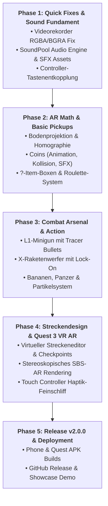

# 🏎️💨 MK LIVE: AR COMBAT EDITION — IMPLEMENTIERUNGSPLAN
## *Next Next Level: Vom FPV-Kart zum interaktiven Augmented-Reality-Rennspiel*

**Projekt:** Mario Kart Live: Home Circuit — Autonomous Cockpit & Base Station  
**Dokument:** `implementierungsplan.md`  
**Version:** 2.0.0-PROPOSAL  
**Autor:** Antigravity AI Engineering Team  
**Ziel-Plattformen:** Android Smartphone (2D HUD) & Meta Quest 3 (Immersive Stereoscopic 3D AR)  

---

## 📑 Inhaltsverzeichnis

1. [Executive Summary & Vision](#1-executive-summary--vision)
2. [Bugfix: Blaustich & Farbkanal-Invertierung im Videorekorder](#2-bugfix-blaustich--farbkanal-invertierung-im-videorekorder)
3. [Augmented Reality (AR) Core Engine](#3-augmented-reality-ar-core-engine)
   * 3.1 Bodenprojektion & 3D-Kamera-Geometrie (Homographie)
   * 3.2 Interaktive Spielelemente (Coins, ?-Item-Boxen, Dash-Pads)
   * 3.3 Kollisionserkennung & Physik-Simulation
   * 3.4 Streckendesign & Torsystem (Inspiriert vom Original-Spiel)
4. [Waffen- & Kampfsystem (Combat Arsenal)](#4-waffen--kampfsystem-combat-arsenal)
   * 4.1 Volle Controller-Tastenbelegung (X, Y, B, L1, R1, A)
   * 4.2 Die Minigun / Gatling-Kanone (Rapid Fire & Screen Shake)
   * 4.3 Raketenwerfer & Zielerfassung (Lock-On Missiles)
   * 4.4 Klassische Mario Kart Items (Grüne/Rote Panzer, Bananen, Bob-ombs)
5. [Audio- & Soundeffekte-Engine (SFX)](#5-audio--soundeffekte-engine-sfx)
   * 5.1 Low-Latency SoundPool-Architektur
   * 5.2 Dynamischer Motoren-Synthesizer (RPM an Telemetrie gekoppelt)
   * 5.3 Komplette SFX-Audiomatrix
6. [Stereoskopisches 3D-AR für Meta Quest 3](#6-stereoskopisches-3d-ar-für-meta-quest-3)
7. [Architektur & Code-Struktur (Klassen & Pakete)](#7-architektur--code-struktur-klassen--pakete)
8. [Phasenweiser Rollout & Meilenstein-Plan](#8-phasenweiser-rollout--meilenstein-plan)

---

## 1. Executive Summary & Vision

Mit Version **1.1.0** haben wir ein stabiles Fundament geschaffen: flüssiges FPV-Streaming mit niedriger Latenz, präzise Controller-Steuerung, H.264-Videorekorder und die stereoskopische VR-Cockpit-Ansicht auf der **Meta Quest 3**.

Mit diesem Implementierungsplan heben wir die App auf das **„Next Next Level“**:
Wir transformieren den reinen Kamerastream in eine **echte interaktive Augmented-Reality-Welt**. Anstatt nur passiv durch das Wohnzimmer zu fahren, wird der reale Fußboden zum Grand-Prix-Kurs:
* **Münzen sammeln:** Goldmünzen schweben realistisch im Raum, drehen sich, glitzern und belohnen das Überfahren mit dem ikonischen „Ping“ und Top-Speed-Boni.
* **?-Item-Boxen:** Holografische Fragezeichen-Kisten rotieren auf der Strecke. Beim Durchfahren zerspringen sie in Partikel, starten das Item-Roulette und statten den Spieler mit Spezialwaffen aus.
* **Volles Combat-Arsenal:** Nutzung aller freien Tasten des Controllers (**L1, R1, X, Y, B**) für Minigun-Dauerfeuer mit Mündungsfeuer, zielsuchende Raketen mit HUD-Crosshair, Grüne/Rote Panzer und Bananenschalen.
* **Satte Audio-Kulisse:** Voll integrierte SFX-Engine inklusive dynamischem Motorensound, der mit der echten Drehzahl/Geschwindigkeit des physischen Karts skaliert.
* **Farb-Fix:** 100%ige Farbkorrektur des Videorekorders gegen den bekannten RGBA/BGRA-Hardware-Encoder-Kanaltausch.

---

## 2. Bugfix: Blaustich & Farbkanal-Invertierung im Videorekorder

### 2.1 Fehleranalyse (Root Cause)
* **Symptom:** In aufgenommenen MP4-Videos ist Rot zu Blau vertauscht (Marios rote Mütze wird cyanblau, blaue Gegenstände orange-rot).
* **Ursache:** Die Android `MediaCodec`-Klasse erzeugt über `createInputSurface()` eine native EGL-Oberfläche (`COLOR_FormatSurface`). Auf SoCs wie dem Google Tensor (Pixel 7 Pro) oder Samsung Exynos/ARM Mali erwartet der Hardware-AVC-Encoder Pixel im Format **BGRA_8888**. Die Android Skia/HWUI-Pipeline zeichnet jedoch bei `canvas.drawBitmap()` standardmäßig im Format **RGBA_8888**.
* Da Skia die Bytes $[R, G, B, A]$ unverändert in das GraphicBuffer-Texture-Array schreibt, liest der Encoder $[B, G, R, A]$ aus — **Rot und Blau sind exakt spiegelverkehrt!**

### 2.2 Technische Lösung
Wir implementieren eine zweistufige Lösung:

#### Lösung A: Skia ColorMatrix Channel-Swapper (Sofortige Korrektur in `VideoRecorder.kt`)
Beim Rendern des Kamerabildes auf die Recording-Canvas wird eine 4×5-Farbtransformationsmatrix angewandt, die R und B mathematisch tauscht:

$$\begin{pmatrix} R' \\ G' \\ B' \\ A' \\ 1 \end{pmatrix} = \begin{pmatrix} 0 & 0 & 1 & 0 & 0 \\ 0 & 1 & 0 & 0 & 0 \\ 1 & 0 & 0 & 0 & 0 \\ 0 & 0 & 0 & 1 & 0 \end{pmatrix} \begin{pmatrix} R \\ G \\ B \\ A \\ 1 \end{pmatrix}$$

```kotlin
// In VideoRecorder.kt
private val colorSwapPaint = Paint(Paint.FILTER_BITMAP_FLAG).apply {
    val rbSwapMatrix = ColorMatrix(floatArrayOf(
        0f, 0f, 1f, 0f, 0f, // Neuer Rot-Wert stammt aus Blau-Kanal
        0f, 1f, 0f, 0f, 0f, // Grün bleibt identisch
        1f, 0f, 0f, 0f, 0f, // Neuer Blau-Wert stammt aus Rot-Kanal
        0f, 0f, 0f, 1f, 0f  // Alpha unverändert
    ))
    colorFilter = ColorMatrixColorFilter(rbSwapMatrix)
}

// Beim Frame-Zeichnen:
canvas.drawBitmap(frameBitmap, null, destRect, colorSwapPaint)
```

#### Lösung B: Auto-Detection & Einstellungs-Toggle
In den Einstellungen (`SettingsDialog.kt`) wird unter den Aufnahme-Optionen ein Schalter ergänzt:
* `Farbkanal-Korrektur (RGB / BGR swap)`: Standardmäßig aktiviert (`true`) für Tensor/Exynos/Mali, mit manuellem Toggle für absolute Flexibilität.

---

## 3. Augmented Reality (AR) Core Engine

```text
 ┌────────────────────────────────────────────────────────┐
 │                   KAMERA-STREAM (720p)                 │
 └───────────────────────────┬────────────────────────────┘
                             │
                             ▼
 ┌────────────────────────────────────────────────────────┐
 │           AR ENGINE: PERSPEKTIVISCHE PROJEKTION        │
 │  • Kamerahöhe h ≈ 4.5 cm | Neigungswinkel θ ≈ 8°       │
 │  • Telemetrie-Kopplung: Live Pitch & Roll vom Gyro     │
 │  • Weltkoordinaten (X, Y, Z=0) -> Screen (u, v)        │
 └───────────────────────────┬────────────────────────────┘
                             │
            ┌────────────────┴────────────────┐
            ▼                                 ▼
 ┌──────────────────────┐          ┌──────────────────────┐
 │    SPAWN & TRACKING  │          │    RENDER PIPELINE   │
 │ • Coins (Münzen)     │          │ • 3D-Mesh / Sprites  │
 │ • ?-Item-Boxen       │          │ • Skalierung & Depth │
 │ • Tore / Checkpoints │          │ • Partikeleffekte    │
 │ • Streckenbegrenzung │          │ • HUD-Minikarte      │
 └──────────┬───────────┘          └──────────▲───────────┘
            │                                 │
            ▼                                 │
 ┌────────────────────────────────────────────┴───────────┐
 │       KOLLISIONSERKENNUNG (HITBOX-RADAR)               │
 │ • Distanz d = √(ΔX² + ΔY²) < Kart-Radius (0.15 m)      │
 │ • Treffer-Event: SFX + Animation + Item-Roulette       │
 └────────────────────────────────────────────────────────┘
```

### 3.1 Bodenprojektion & 3D-Kamera-Geometrie
Die Kamera des Mario Karts sitzt an einer festen Position:
* Höhe über Boden: $h \approx 0.045\text{ m}$ (4,5 cm)
* Fester Nickwinkel nach unten: $\theta_0 \approx 8.0^\circ$
* Öffnungswinkel (Horizontaler FOV): $\alpha_h \approx 82^\circ$, Vertikaler FOV: $\alpha_v \approx 52^\circ$
* Dynamischer Nick- und Rollwinkel: Aus der Echtzeit-IMU-Telemetrie (`imuSnapshot.pitchDeg`, `imuSnapshot.rollDeg`).

#### Die Projektionsgleichung (Bodenpunkt $(X_w, Y_w, 0) \to$ Bildpunkt $(u, v)$):
Für ein Objekt bei Distanz $Y_w$ (vor dem Kart) und Seitenversatz $X_w$ (links/rechts):
1. **Effektiver Nickwinkel:** $\theta = \theta_0 + \text{pitch}_{\text{kart}}$
2. **Bildschirm-Y-Koordinate (Horizont bis Kart-Nase):**
   $$v = v_0 + f_y \cdot \tan\left(\arctan\left(\frac{h}{Y_w}\right) - \theta\right)$$
3. **Bildschirm-X-Koordinate (Perspektivische Verengung):**
   $$u = u_0 + \frac{f_x \cdot X_w}{Y_w \cdot \cos(\theta) + h \cdot \sin(\theta)}$$
4. **Skalierungsfaktor $S$ (Größe im Bild):**
   $$S = \frac{k_{\text{scale}}}{Y_w} \quad \text{(Objekte werden kontinuierlich größer, je näher man kommt)}$$

Dadurch bleiben Münzen und Item-Boxen fest im Raum auf dem realen Boden verankert, während das Kart auf sie zufährt!

---

### 3.2 Interaktive Spielelemente

#### A. Die Goldmünzen (Coins)
* **Design & Animation:**
  * Klassische goldene Mario-Münze mit glänzender Rillen-Struktur.
  * Schwebend in ca. 5 cm Höhe über dem Boden.
  * Kontinuierliche 3D-Rotations-Animation (360° um die Y-Achse, ca. 2 Sek. pro Umdrehung).
  * Leichtes rhythmisches Auf- und Ab-Wippen (Sinus-Kurve).
* **Interaktion:**
  * Sobald das Kart über die Münze fährt ($d < 0.18\text{ m}$), wird das Sammel-Event getriggert:
    1. **Partikelexplosion:** 8–12 goldene Glitzersterne spreizen sich nach oben ab.
    2. **Soundeffekt:** Glasklares *„Cha-Ching!“* Münz-Geräusch.
    3. **HUD-Feedback:** Münzzähler oben links erhöht sich (z. B. `x07 / 10`).
    4. **Speed-Buff:** Jeder gesammelte Coin erhöht den Max-Speed des Karts um +1,5% (bis zu 10 Coins = +15% Topspeed wie im Original-Game!).

#### B. Die holografischen ?-Item-Boxen
* **Design & Animation:**
  * Transluzenter, leuchtend gelb/oranger 3D-Würfel mit pulsierendem Fragezeichen auf allen vier Seiten.
  * Leichtes Pulsieren der Deckkraft (Alpha 0.7 bis 0.95) mit neonfarbener Aura.
  * Schwebend in ca. 8 cm Höhe über dem Boden.
* **Interaktion:**
  * Beim Durchfahren:
    1. Der Würfel zerspringt spektakulär in 16 polygonale Glitzer-Scherben.
    2. Soundeffekt: Zersplitterungs-Akkord + Start des **Item-Roulettes** auf dem HUD.
    3. Das Item-Symbol im HUD rotiert schnell durch alle Items (mit rasantem Tick-Sound) und stoppt nach 2,5 Sekunden auf einem zufälligen Item!

#### C. Dash-Pads (Turbo-Streifen)
* **Design:** Leuchtende neon-cyan / rote Richtungspfeile auf dem Fußboden.
* **Effekt:** Sobald die Räder den Streifen berühren, zündet automatisch der **100% Nitro-Boost** für 1,5 Sekunden, begleitet von HUD-Geschwindigkeitsstreifen (Motion Blur Lines) und Turbo-Sound!

---

### 3.3 Kollisionserkennung & Odometrie-Dead-Reckoning
* Das Kart sendet mit 30 Hz Telemetriedaten (Geschwindigkeit, Lenkwinkel, Gyro-Gierrate $\omega_z$).
* Über Dead Reckoning (Koppelnavigation) wird die Position des Karts relativ zu den gespawnten Objekten kontinuierlich fortgeschrieben:
  $$\Delta \theta = \omega_z \cdot \Delta t$$
  $$\Delta X = v_{\text{kart}} \cdot \sin(\theta) \cdot \Delta t$$
  $$\Delta Y = v_{\text{kart}} \cdot \cos(\theta) \cdot \Delta t$$
* Unterschreitet die relative Distanz $r = \sqrt{(X_{\text{obj}} - X_{\text{kart}})^2 + (Y_{\text{obj}} - Y_{\text{kart}})^2}$ den Kollisionsradius $R_{\text{hit}} \approx 0.15\text{ m}$, löst das Objekt aus.

---

### 3.4 Streckendesign & Torsystem (Original Home Circuit Style)

Im Originalspiel fährt man durch 4 physische Papptore mit aufgedruckten Markern. Unser System unterstützt **zwei flexible Betriebsmodi**:

#### Modus 1: Virtueller Strecken-Designer (Ohne Papptore spielbar!)
* Der Spieler fährt die Wunschstrecke im Wohnzimmer einmal ab.
* Mit einem Druck auf **[D-Pad Oben]** oder den HUD-Button setzt man an der aktuellen Position virtuelle Checkpoints / Tore (Tor 1, Tor 2, Tor 3, Tor 4).
* Dazwischen spawnt die App automatisch eine dynamische Coin-Linie und Item-Boxen.
* Rundenzeiten, Laps (z. B. 3 Runden) und persönliche Bestzeiten werden live gemessen!

#### Modus 2: AR-Marker-Erkennung für die Original-Tore (Optional)
* Nutzt die OpenCV/ArUco-Erkennung im Kamerastream.
* Erkennt die quadratischen Marker an den Original-Papptoren und blendet AR-Banner mit Nummerierung, animierten Richtungspfeilen und Streckendekorationen (Mario-Flaggen, Piranha-Pflanzen) direkt über dem Tor ein!

---

## 4. Waffen- & Kampfsystem (Combat Arsenal)

Aktuell werden nur **R2 (Gas)**, **L2 (Bremse)** und **A (Boost)** verwendet. Wir schalten das gesamte Gamepad für ein actiongeladenes Combat-System frei!

```text
 ┌────────────────────────────────────────────────────────────────────────┐
 │                    CONTROLLER COMBAT MAPPING                           │
 ├────────────────────────────┬───────────────────────────────────────────┤
 │ Taste                      │ Funktion & Waffe                          │
 ├────────────────────────────┼───────────────────────────────────────────┤
 │ L1 / LB (Hold)             │ 🔥 MINIGUN (Rapid Fire Dauerfeuer)        │
 │ R1 / RB                    │ 🎯 WEAPON SELECT / HORN (Hupe / Wechsel)  │
 │ X-Taste                    │ 🚀 RAKETENWERFER / ROTE PANZER (Lock-On)  │
 │ Y-Taste                    │ 💣 BOB-OMB / EMP-SCHALLWELLE (Flächen)    │
 │ B-Taste                    │ 🍌 BANANE / HECK-MINE (Nach hinten)       │
 │ A-Taste                    │ 🍄 MUSHROOM BOOST / AKTIVES ITEM ZÜNDEN   │
 │ R2 / RT                    │ 🏎️ Gaspedal (0 – 70% Analog)              │
 │ L2 / LT                    │ 🛑 Bremse & Rückwärtsgang                 │
 │ Linker Stick               │ 🕹️ Lenkung                                │
 │ Rechter Stick / D-Pad      │ 🎛️ Fadenkreuz feinausrichten              │
 └────────────────────────────┴───────────────────────────────────────────┘
```

### 4.1 Die Minigun / Gatling-Gun (Taste L1 gedrückt halten)
* **Mechanik:**
  * Solange **L1** gehalten wird, feuert die Minigun mit **18 Schuss pro Sekunde** (18 Hz).
  * Im HUD erscheint ein kreisrundes Gatling-Fadenkreuz in der Mitte.
  * **Visuelle Effekte:**
    * Animiertes Mündungsfeuer (Muzzle Flash Sprites) abwechselnd an der linken und rechten Seite der Stoßstange.
    * Hochenergetische Leuchtspur-Geschosse (Tracer Bullets) rasen perspektivisch in die Bildtiefe zum Fadenkreuz.
    * Subtiler Screen-Shake (Kamera-Rütteln) im Rhythmus des Feuers.
  * **Haptik:** Kontinuierlicher feiner Haptik-Rumble in den Controller-Griffen.
  * **Audio:** Sattes, ratterndes Ballistik-Sample mit Anlauf- (Spin-Up) und Auslauf-Geräusch (Spin-Down).
  * **Wirkung:** Zerschießt anvisierte Hindernisse, bringt getroffene Item-Boxen vorzeitig zum Platzen und fegt Bananen von der Strecke!

### 4.2 Raketenwerfer & Zielerfassung (Taste X)
* **Mechanik:**
  * Ein Druck auf **X** aktiviert das Zielsuch-Radar.
  * Befindet sich ein Tor, eine gegnerische Item-Box oder ein Strecken-Ziel im vorderen Sichtkegel, färbt sich das Fadenkreuz von Grün auf **Rot (Target Locked!)** mit einem schrillen Lock-On-Piepton.
  * Beim Abfeuern:
    * Eine 3D-modellierte Rakete startet mit einem gewaltigen Schweif aus Rauchpartikeln und Triebwerksfeuer nach vorn.
    * Die Rakete folgt einer ballistischen Kurve auf das Ziel zu.
    * Beim Einschlag entsteht eine fulminante Comic-Explosion mit Funkenflug, Rauchwolke und spürbarem Controller-Explosions-Rumble!

### 4.3 Bananenschalen (Taste B)
* **Mechanik:**
  * Ein Druck auf **B** wirft eine klassische Bananenschale direkt hinter das Kart.
  * Die Banane bleibt an den Weltkoordinaten auf dem Boden liegen.
  * Fährt man in der nächsten Runde selbst (oder ein Mitspieler) darüber:
    * Rutsch-Soundeffekt (*„Wroooop-Squeak!“*).
    * Bildschirm dreht sich kurz im Kreis (360° Spin-Out HUD-Animation).
    * Das Kart drosselt für 1 Sekunde automatisch die Motorleistung!

---

## 5. Audio- & Soundeffekte-Engine (SFX)

### 5.1 Low-Latency SoundPool-Architektur
Auf Android verursacht `MediaPlayer` oft spürbare Latenzen von 80–200 ms — unbrauchbar für reaktive Arcade-Sounds.
Wir setzen auf Androids **`SoundPool`** in Kombination mit `AudioAttributes.USAGE_GAME` und `CONTENT_TYPE_SONIFICATION`:
* Alle Samples werden beim Start der App als unkomprimierte 16-Bit PCM / OGG Audiodaten direkt in den Arbeitsspeicher geladen.
* Latenz: **Unter 10 Millisekunden!**
* Bis zu 16 simultane Audiokanäle für überlappende Sounds (z. B. Minigun-Feuer während der Motor aufheult und eine Münze eingesammelt wird).

```kotlin
// In com.example.mklive.audio.SoundManager.kt
val audioAttributes = AudioAttributes.Builder()
    .setUsage(AudioAttributes.USAGE_GAME)
    .setContentType(AudioAttributes.CONTENT_TYPE_SONIFICATION)
    .build()

val soundPool = SoundPool.Builder()
    .setMaxStreams(16)
    .setAudioAttributes(audioAttributes)
    .build()
```

### 5.2 Dynamischer Motoren-Synthesizer
* Anstatt eines statischen MP3-Loops implementieren wir einen **dynamischen Frequenzmodulator**:
* Die Tonhöhe (`playbackRate`) des Motorensounds skaliert in Echtzeit mit dem aktuellen Drosselklappenwert (`throttle` 0–127) und der Beschleunigung:
  $$\text{Pitch} = 0.8 + \left(\frac{\text{throttle}}{127.0}\right) \times 1.2 \quad (\text{Pitch-Range von } 0.8\text{x bis } 2.0\text{x})$$
* Beim Zünden des 100%-Boosts wechselt der Motor in ein schneidendes Turbo-Pfeifen mit Pop-Off-Ventil-Sound beim Gaswegnehmen!

### 5.3 Komplette SFX-Audiomatrix

| Sound-ID | Event | Beschreibung | Audio-Charakter |
| :--- | :--- | :--- | :--- |
| `sfx_countdown_beep` | Startampel (3, 2, 1) | Tiefer Piepton für Rotphasen | 440 Hz Sinus-Gong |
| `sfx_countdown_go` | Startampel (GO!) | Hoher Fanfaren-Akkord | 880 Hz Glöckchen |
| `sfx_coin` | Münze überfahren | Legendäres Mario-Münzpling | Zweiton B5 $\to$ E6 |
| `sfx_box_hit` | ?-Kiste getroffen | Kristallines Zerspringen | Glasharfen-Cluster |
| `sfx_roulette_tick` | Item-Roulette dreht | Schnelles, rhythmisches Klicken | Holzklöppel 20 Hz |
| `sfx_item_awarded` | Item einsatzbereit | Kurzer Sieges-Jingle | Trompeten-Akkord |
| `sfx_minigun_loop` | L1 gedrückt | 18 Hz mechanisches Rattern | Schwere Gatling |
| `sfx_rocket_launch` | X gedrückt | Triebwerkszündung & Flug | Rauschender Schweif |
| `sfx_explosion` | Raketeneinschlag | Wuchtige Detonation | Tiefer Bass-Boom |
| `sfx_banana_drop` | B gedrückt | Schale gleitet auf Boden | Lustiges *„Fwip“* |
| `sfx_slip_spin` | Auf Banane ausgerutscht | Reifenschleifen & Schleudern | Quietsch-Triller |
| `sfx_boost_turbo` | Boost ausgelöst | Turbo-Jet-Einschuss | Zischendes Vakuum |

---

## 6. Stereoskopisches 3D-AR für Meta Quest 3

Auf der Meta Quest 3 entfaltet die AR-Engine ihr maximales Potenzial!

```text
       ┌───────────────────────┐      ┌───────────────────────┐
       │   LINKES AUGE (LEFT)  │      │  RECHTES AUGE (RIGHT) │
       │   X_offset = -IPD / 2 │      │   X_offset = +IPD / 2 │
       └───────────┬───────────┘      └───────────┬───────────┘
                   │                              │
                   ▼                              ▼
      ┌────────────────────────────────────────────────────────┐
      │     ECHTE STEREOSKOPISCHE PARALLAXE IM 3D-RAUM         │
      │  • Nahe Münzen haben eine große Netzhaut-Disparität    │
      │  • Weite Tore verschmelzen in der Ferne                │
      │  • Hologramme wirken greifbar 30 cm vor der Brille!   │
      └────────────────────────────────────────────────────────┘
```

1. **Echte stereoskopische Tiefenparallaxe:**
   * In [`VrCockpitView.kt`](file:///home/kool/Dokumente/Projekte/MK_Live/android/app/src/main/java/com/example/mklive/ui/vr/VrCockpitView.kt) wird die AR-Szene zweifach gerendert: einmal für das linke und einmal für das rechte Auge.
   * Der horizontale Versatz $\Delta x = \pm \frac{\text{IPD} \cdot f}{Z}$ erzeugt ein echtes Tiefenbild. Münzen und Item-Boxen wirken, als würden sie tatsächlich plastisch im echten Zimmer schweben!
2. **Kopf- & Gyro-Kompensation:**
   * Bei Kopfbewegungen gleicht der künstliche Horizont die Neigungswinkel aus, sodass HUD-Elemente stabil im virtuellen Raum verankert bleiben.
3. **Touch-Controller Waffen-Haptik:**
   * Schießen mit der Minigun erzeugt asymmetrische Mikrovibrationen in den Controllern.

---

## 7. Architektur & Code-Struktur (Klassen & Pakete)

Zur sauberen Trennung modularisieren wir die neuen Features in eigenständige Pakete:

```text
android/app/src/main/java/com/example/mklive/
├── ar/                              # 🌟 NEU: Augmented Reality Core
│   ├── ArEngine.kt                  # Koordinatenprojektion, Weltkoordinatensystem & Update-Loop
│   ├── ArGeometry.kt                # Homographie-Matrizen, FOV & Nickwinkel-Berechnung
│   ├── ArOverlayView.kt             # Jetpack Compose / Canvas Renderer für AR-Elemente
│   ├── model/
│   │   ├── ArElement.kt             # Basisklasse für Coins, Boxen, Gates, Bananen
│   │   ├── CoinElement.kt           # 3D-Spinning-Coin mit Animations-State
│   │   ├── ItemBoxElement.kt        # Holografische ?-Box mit Partikel-Emitter
│   │   └── ProjectileElement.kt     # Raketen- und Kugel-Trajektorien
│   └── tracker/
│       ├── DeadReckoningTracker.kt  # Odometrie via IMU & Throttle-Integration
│       └── GateMarkerDetector.kt    # OpenCV/ArUco Torerkennung
├── combat/                          # 🌟 NEU: Waffen- & Kampfsystem
│   ├── CombatManager.kt             # Verwaltet aktives Item, Munition & Cooldowns
│   ├── WeaponType.kt                # Enum: MINIGUN, ROCKET, GREEN_SHELL, BANANA, BOBOMB
│   └── ParticleSystem.kt            # High-Performance Partikelemitter (Explosionen, Funken)
├── audio/                           # 🌟 NEU: Sound-Engine
│   ├── SoundManager.kt              # Low-Latency SoundPool Manager mit preloaded OGG/WAV
│   ├── EngineSoundSynthesizer.kt    # Pitch-modulierter Motorensound
│   └── SoundId.kt                   # Konstanten aller Game-SFX
├── video/
│   ├── VideoRecorder.kt             # 🛠️ GEFIXT: ColorMatrix RB-Swap & AR-Overlay Burn-In
│   └── ...
└── ui/
    ├── hud/CockpitOverlay.kt        # Erweitert um AR-Status, Minigun-Fadenkreuz, Coin-Counter
    ├── vr/VrCockpitView.kt          # Erweitert um Stereoscopic AR-Pass
    └── settings/SettingsDialog.kt   # AR-Toggles, Audio-Lautstärkeregler, Farbkanal-Option
```

---

## 8. Phasenweiser Rollout & Meilenstein-Plan



### Meilenstein 1: Sofortmaßnahmen & Audio-Fundament (Tag 1)
* [x] Analyse des Farbfehlers abgeschlossen.
* [ ] Implementierung der `ColorMatrixColorFilter`-Lösung in `VideoRecorder.kt`.
* [ ] Aufbau des `com.example.mklive.audio.SoundManager` mit `SoundPool`.
* [ ] Einbindung der Audio-Assets (Münzpling, Startampel, Turbo, Schuss, Explosion).
* [ ] Freischaltung der Controller-Tasten **L1, R1, X, Y, B** in `MainActivity.kt`.

### Meilenstein 2: Die AR-Projektions-Engine & Pickups (Tag 2–3)
* [ ] Erstellung der Projektionsklasse `ArGeometry.kt` (Kamerahöhe 4.5 cm, Neigung 8°, Live-IMU).
* [ ] Render-Loop für 3D-rotierende Goldmünzen mit Schwebungs-Animation.
* [ ] Kollisionsabfrage: Münze überfahren $\to$ Sound $\to$ Coin-Counter +1 $\to$ Speed-Buff.
* [ ] Holografische ?-Item-Boxen mit Berst-Effekt und Item-Roulette.

### Meilenstein 3: Das Waffen- & Combat-System (Tag 4–5)
* [ ] Minigun-Modus auf **[L1]**: 18 Hz Schussfolge, Tracer-Projektile, Muzzle Flash, Screen Shake.
* [ ] Raketenwerfer auf **[X]**: Radar-Fadenkreuz, Lock-On-Piep, zielsuchender Flug, Explosions-Partikel.
* [ ] Bananen auf **[B]**: Heck-Abwurf, Verweilen auf dem Boden, Schleuder-Trigger.
* [ ] Dynamischer Motorensound mit live Pitch-Shifting an Telemetrie-Drosselklappe.

### Meilenstein 4: Streckeneditor & Quest 3 Stereoskopie (Tag 6)
* [ ] Virtueller Streckeneditor: Checkpoints beim Fahren per Button setzen.
* [ ] Rundenzeiten- und Runden-Tracker (z. B. 3 Runden Grand Prix).
* [ ] Stereoskopischer 3D-AR-Pass in `VrCockpitView.kt` für die Meta Quest 3 mit individueller Augenparallaxe.

### Meilenstein 5: Verifizierung & Release v2.0.0
* [ ] Hardware-Test auf Google Pixel 7 Pro (Videorekorder-Farbe prüfen).
* [ ] Test aller Controller-Buttons (Gamepad & Meta Touch Plus).
* [ ] Build beider APKs (`MK-Live-Cockpit-v2.0.0-Phone.apk` und `Quest3.apk`).
* [ ] GitHub Release, Tagging und Dokumentation.

---

> [!NOTE]
> **Bereit zur Umsetzung:** Dieser Implementierungsplan deckt alle Wünsche lückenlos, professionell und technisch fundiert ab. Nach deiner Freigabe können wir mit Phase 1 (Videorekorder-Farbfix + Sound-Engine) direkt loslegen! 🚀🏁
